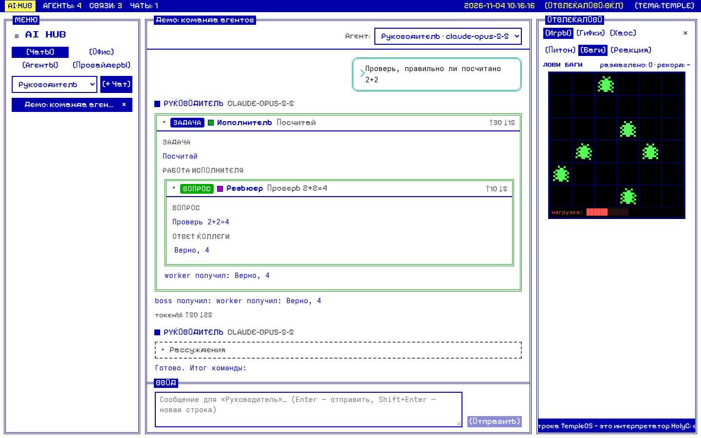
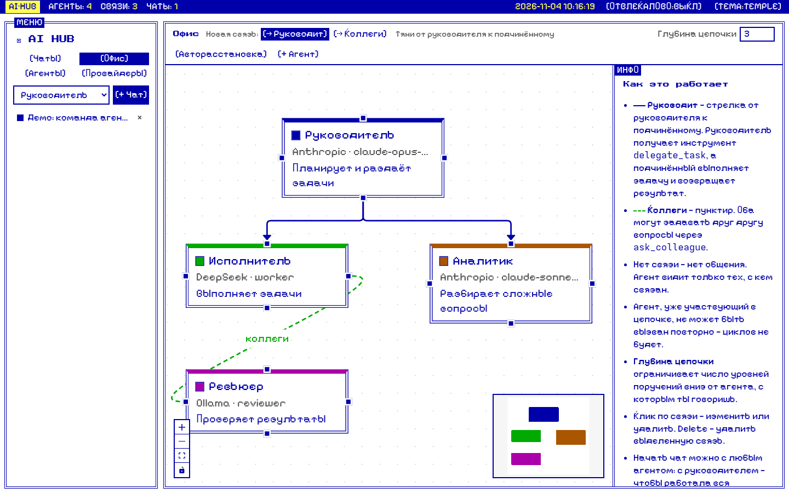
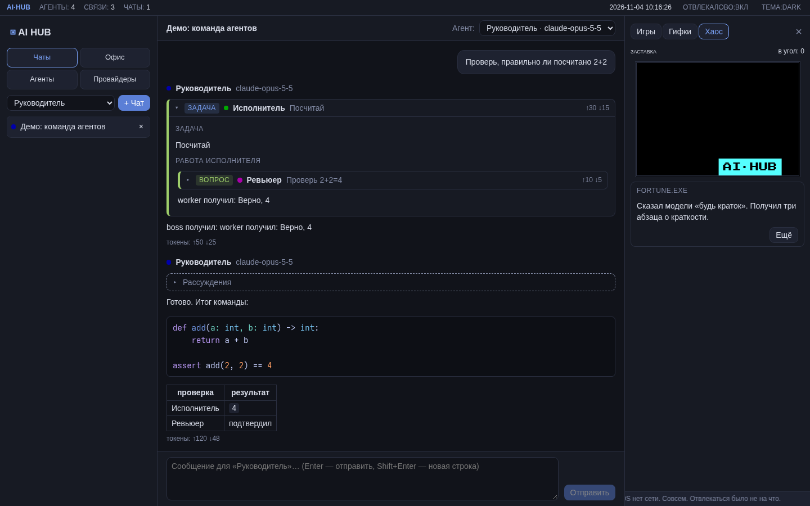
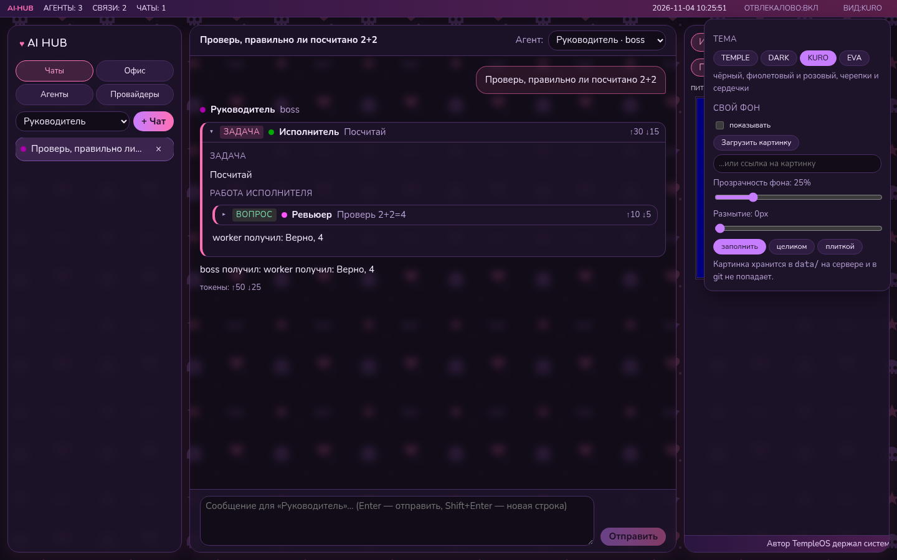
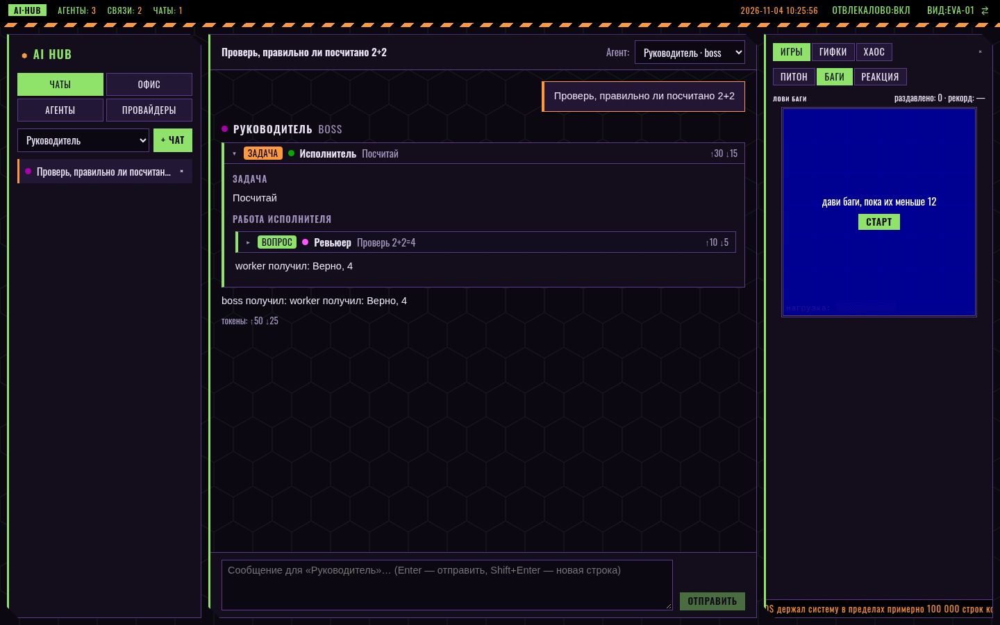
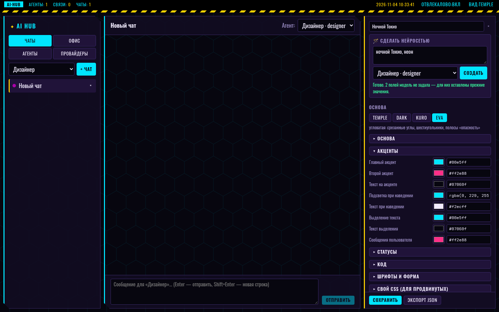

# AI Hub

**Веб-интерфейс для работы с нейросетями и командами ИИ-агентов.** Claude, ChatGPT, DeepSeek, Grok, Gemini, Mistral, локальные модели через Ollama — в одном окне. Агентов можно собрать в «офис»: кто кем руководит, кто с кем советуется. Руководитель сам раздаёт задачи, исполнители работают, а ты видишь всё дерево поручений в реальном времени.

Оформлено в стиле TempleOS: 16 цветов EGA, двойные рамки, пиксельный шрифт. Есть и обычная тёмная тема.

> *English:* a self-hosted web UI for chatting with LLMs and orchestrating teams of AI agents (Claude, OpenAI, DeepSeek, Grok, Gemini, Ollama and any OpenAI-compatible API). Draw an org chart — who manages whom, who consults whom — and a lead agent delegates tasks to the others. Node.js + React, SQLite, no external services required. UI is in Russian.



---

## Содержание

- [Возможности](#возможности)
- [Быстрый старт](#быстрый-старт)
- [Первые шаги](#первые-шаги)
- [Провайдеры и где взять ключи](#провайдеры-и-где-взять-ключи)
- [Офис: как агенты работают вместе](#офис-как-агенты-работают-вместе)
- [Панель «Отвлекалово»](#панель-отвлекалово)
- [Темы и свой фон](#темы-и-свой-фон)
  - [Свои темы](#свои-темы)
  - [Тема нейросетью](#тема-нейросетью)
  - [Формат темы и переменные](#формат-темы-и-переменные)
  - [Делиться темами](#делиться-темами)
  - [Новая встроенная тема в коде](#новая-встроенная-тема-в-коде)
- [Настройка](#настройка)
- [Запуск для лаборатории или сервера](#запуск-для-лаборатории-или-сервера)
- [Безопасность](#безопасность)
- [Как устроено](#как-устроено)
- [Как добавить новый тип API](#как-добавить-новый-тип-api)
- [Частые ошибки](#частые-ошибки)
- [Как помочь проекту](#как-помочь-проекту)
- [Ограничения и планы](#ограничения-и-планы)

---

## Возможности

- **Любые нейросети.** Три типа API покрывают почти всё:
  - Anthropic Messages API — Claude;
  - OpenAI Chat Completions — ChatGPT, DeepSeek, Grok, Gemini, Mistral, Groq, OpenRouter, Ollama, vLLM, LM Studio;
  - OpenAI Responses API — Codex и reasoning-модели OpenAI.
- **Готовые пресеты** для популярных провайдеров: выбрал, вставил ключ, нажал «Проверить» — список моделей подтянется сам.
- **Агенты.** Модель + системный промпт + настройки (effort / temperature / max tokens). Сколько угодно агентов на одном ключе.
- **Офис.** Визуальный редактор оргструктуры: перетаскиваешь агентов, проводишь стрелки «руководит» и пунктир «коллеги». Права агентов берутся только из связей.
- **Делегирование.** Руководитель получает инструмент `delegate_task`, коллеги — `ask_colleague`. Поручения идут параллельно, вложенность настраивается, циклы исключены.
- **Прозрачность.** В чате видно дерево: кто кому что поручил, как исполнитель работал, что ответил, сколько токенов потратил.
- **Стриминг.** Ответы и рассуждения моделей приходят в реальном времени. Генерация идёт на сервере: можно перезагрузить страницу — поток подхватится. Есть кнопка «Стоп».
- **Markdown и подсветка кода**, таблицы.
- **Четыре темы:** TEMPLE (16 цветов EGA, по умолчанию), DARK, KURO (чёрно-фиолетово-розовая, с черепками и сердечками) и EVA (угловатые панели, шестиугольники, три цветовые гаммы с переключением).
- **Свои темы.** Редактор с живым предпросмотром: цвета, шрифты, скругления, свой CSS. Экспорт и импорт в JSON — темами можно делиться.
- **Темы нейросетью.** Описываешь словами («ночной Токио, неон») — любой твой агент придумывает тему, ты дорабатываешь и сохраняешь.
- **Свой фон:** любая картинка под интерфейсом с настройкой прозрачности и размытия.
- **«Отвлекалово»:** мини-игры, автолента мемов и гифок, заставка и шутки — в боковой панели.
- **Всё локально.** Один процесс Node.js, база — один файл SQLite. Ключи не уходят в браузер.

| Офис | Тёмная тема |
|---|---|
|  |  |
| **KURO и меню «Вид»** | **EVA, гамма 01** |
|  |  |

---

## Быстрый старт

Нужен **Node.js 22.18 или новее** (разработка и проверка — на Node.js 26). Больше ничего: база встроена в Node.js, TypeScript-сервер запускается без сборки.

```bash
git clone https://github.com/<твой-аккаунт>/ai-hub.git
cd ai-hub
npm install
npm run dev
```

Открой **http://localhost:5173**.

`npm run dev` запускает два процесса: API-сервер на `:8787` (перезапускается при изменении кода) и Vite с горячей перезагрузкой интерфейса на `:5173`.

Режим «как в продакшене» — один процесс, интерфейс раздаёт сам сервер:

```bash
npm run build
npm start          # http://127.0.0.1:8787
```

---

## Первые шаги

1. **Провайдеры → «+ Добавить провайдера».** Выбери пресет (например, DeepSeek или Ollama), вставь ключ, сохрани. Кнопка «Проверить» покажет, видит ли сервер модели.
2. **Агенты → «+ Добавить агента».** Задай имя, выбери провайдера и модель (подсказки из списка моделей появятся сами), напиши системный промпт. Для быстрого старта есть шаблоны ролей: Руководитель, Исполнитель, Ревьюер.
3. **Офис.** Протяни стрелку от руководителя к исполнителю. Если нужно, чтобы двое советовались, — переключись на «Коллеги» и соедини их.
4. **Чаты.** Выбери агента в левой панели, нажми «+ Чат» и дай задачу. Если это руководитель — он сам решит, кому что поручить.

> Пример недорогой команды: руководитель — Claude Sonnet или Opus, исполнители — DeepSeek или локальные модели через Ollama, ревьюер — ещё одна модель другого вендора.

---

## Провайдеры и где взять ключи

Ключ создаётся в консоли провайдера. В AI Hub он вставляется один раз на странице «Провайдеры».

| Провайдер | Тип API | Base URL (подставляется пресетом) | Где взять ключ |
|---|---|---|---|
| Claude | `anthropic` | — | platform.claude.com → API Keys |
| ChatGPT / OpenAI | `openai` | `https://api.openai.com/v1` | platform.openai.com → API keys |
| OpenAI Codex | `openai-responses` | `https://api.openai.com/v1` | тот же ключ OpenAI |
| DeepSeek | `openai` | `https://api.deepseek.com` | platform.deepseek.com → API keys |
| Grok (xAI) | `openai` | `https://api.x.ai/v1` | console.x.ai |
| Gemini | `openai` | `https://generativelanguage.googleapis.com/v1beta/openai/` | aistudio.google.com |
| Mistral | `openai` | `https://api.mistral.ai/v1` | console.mistral.ai |
| Groq | `openai` | `https://api.groq.com/openai/v1` | console.groq.com |
| OpenRouter | `openai` | `https://openrouter.ai/api/v1` | openrouter.ai → Keys |
| Ollama | `openai` | `http://localhost:11434/v1` | ключ не нужен |
| vLLM, LM Studio и др. | `openai` | адрес твоего сервера | обычно не нужен |

Важно:

- **API оплачивается отдельно от подписок.** ChatGPT Plus, Claude Pro/Max и т.п. к API не относятся: в консоли провайдера нужно пополнить баланс, оплата идёт за токены.
- **Ключ показывается один раз** при создании — сразу скопируй.
- **Доступность по странам** у провайдеров разная. Проверь условия провайдера для своего региона.
- **Бесплатный вариант** — [Ollama](https://ollama.com): модели работают на твоём компьютере, ключи не нужны. Добавь пресет «Ollama (локально)», и модели из `ollama list` появятся сами.
- Для Claude ключ можно не вводить в интерфейсе, а задать переменной `ANTHROPIC_API_KEY` (см. [Настройка](#настройка)).

### Настройки агента по типу API

| | `anthropic` | `openai` | `openai-responses` |
|---|---|---|---|
| Effort (глубина рассуждений) | да | — | да (reasoning effort) |
| Temperature | — | да | — |
| Показ рассуждений | краткий пересказ | если модель отдаёт (DeepSeek-reasoner, Ollama) | краткий пересказ |

---

## Офис: как агенты работают вместе

Вкладка **«Офис»** — холст, на котором агенты стоят карточками. Связи рисуются мышкой: тянешь от одной карточки к другой.

| Связь | Вид | Что даёт |
|---|---|---|
| **Руководит** | сплошная стрелка от руководителя к подчинённому | руководитель получает инструмент `delegate_task` и может поручать подчинённому задачи; тот выполняет и возвращает результат |
| **Коллеги** | зелёный пунктир | оба получают `ask_colleague` и могут задавать друг другу вопросы |

Правила:

- **Нет связи — нет общения.** Агент знает только тех, с кем связан, и видит их описание роли.
- **Без циклов.** Агента, который уже участвует в текущей цепочке, вызвать повторно нельзя.
- **Глубина цепочки** (в панели офиса) ограничивает, на сколько уровней вниз уходят поручения от агента, с которым ты говоришь.
- **Исполнитель не видит переписку.** Руководитель передаёт всё нужное в тексте задачи — это прописано в описании инструмента.
- Начать чат можно с **любым** агентом. С руководителем — чтобы работала вся команда.
- Клик по связи — поменять направление, тип или удалить. Клик по агенту — его связи и кнопка «Начать чат». «Авторасстановка» раскладывает схему по уровням.

В чате поручения показываются вложенными карточками с пометкой «задача» или «вопрос», статусом и расходом токенов.

---

## Панель «Отвлекалово»

Боковая панель справа; скрывается крестиком или кнопкой `[ОТВЛЕКАЛОВО]` в статус-строке. На узких экранах прячется сама.

- **Игры:** «Питон в ring 0» (змейка), «Лови баги», тест реакции. Рекорды сохраняются в браузере.
- **Гифки → Авто:** лента подгружается сама.
  - «Мемы» и «Гифки» — свежие посты Reddit через [meme-api.com](https://github.com/D3vd/Meme_Api), ключ не нужен; NSFW и спойлеры отфильтрованы.
  - «GIPHY» — нужен бесплатный ключ (developers.giphy.com → Create an App → API). Вставляется прямо в панели или через `GIPHY_API_KEY`.
  - Клик по картинке — на весь экран.
- **Гифки → Мои ссылки:** свои ссылки на YouTube, TikTok, `.gif`, `.mp4`; кнопка ⛶ открывает большой плеер.
- **Хаос:** заставка с логотипом, счётчик попаданий в угол, шутки.

> Ленты Reddit и GIPHY — живой сторонний контент. Фильтры отсекают помеченное как NSFW, но модерации со стороны AI Hub нет.

---

## Темы и свой фон

Кнопка **`[ВИД]`** в правом верхнем углу открывает меню оформления.

| Тема | Что это |
|---|---|
| **TEMPLE** | по мотивам TempleOS: белый фон, 16 цветов EGA, двойные рамки, пиксельный шрифт |
| **DARK** | спокойная тёмная тема |
| **KURO** | чёрный, фиолетовый и розовый; мягкие скругления; фоновый узор из черепков, сердечек, звёзд и летучих мышей |
| **EVA** | чёрный фон, угловатые панели, сетка шестиугольников, полосы «опасность»; гаммы **01** (пурпур/зелёный), **02** (красный/оранжевый), **00** (синий/белый). Кнопка `⇄` рядом с `[ВИД]` переключает гамму |

### Свой фон

Работает в любой теме. Загрузи картинку (png, jpg, gif, webp, avif — до 15 МБ) или вставь ссылку, затем настрой прозрачность, размытие и режим («заполнить», «целиком», «плиткой»). Панели станут полупрозрачными, и картинка будет просвечивать. Загруженный файл хранится в `data/background` на сервере и в git не попадает — туда можно положить любые обои, в том числе с любимыми персонажами, не публикуя их.

Выбранная тема, гамма и настройки фона запоминаются в браузере.

### Свои темы



**`[ВИД]` → «+ Новая».** Справа откроется редактор, а за ним продолжит работать весь интерфейс — каждое изменение видно сразу.

1. **Основа** — встроенная тема, от которой берутся форма и декор: TEMPLE (рамки, `[кнопки]`), DARK (аккуратно и строго), KURO (скругления, градиенты, узор), EVA (срезанные углы, шестиугольники). Цвета ты задаёшь сам.
2. **Цвета** по группам: основа, акценты, статусы, подсветка кода. Палитрой или текстом — `#rrggbb`, `rgba(...)`, `hsl(...)`. Для полупрозрачных панелей используй `rgba`.
3. **Шрифты и форма:** шрифт интерфейса, заголовков и сообщений, размеры текста, скругление углов, значок логотипа (любой символ или эмодзи).
4. **Свой CSS** — для продвинутых: любые правила поверх темы.
5. **Сохранить** — тема появится в меню «Вид» в разделе «Свои темы». Изменить её можно кнопкой «✎ Изменить», когда она выбрана.

Новая тема стартует со значений текущей — удобно взять встроенную и поменять пару цветов. Закрыть без сохранения — `Esc` или ×, всё вернётся как было.

### Тема нейросетью

В редакторе есть блок **🪄 «Сделать нейросетью»**:

1. Опиши тему словами: «ночной Токио, неон», «уютная осень», «как терминал из 80-х, янтарный на чёрном», «пастельная, для долгой работы ночью».
2. Выбери агента — подойдёт любой настроенный, хоть локальная модель через Ollama.
3. Нажми «Создать». Модель вернёт тему, она сразу применится для предпросмотра — поправь, что не нравится, и сохрани.

Как это устроено и почему это безопасно:

- агент получает отдельную инструкцию дизайнера (`themeGenerationPrompt` в `shared/themes.ts`) — его собственный системный промпт не используется;
- от ответа берутся **только известные переменные с корректными значениями** (цвета, шрифты из списка, размеры в допустимых пределах); свой CSS от нейросети не принимается вообще;
- если модель заполнила не всё, недостающее выводится из заданного (например, выделение — из акцента), остальное остаётся от текущей темы;
- лучше всего справляются сильные модели (Claude, GPT, DeepSeek); маленьким локальным иногда нужно переформулировать запрос.

### Формат темы и переменные

Тема — это JSON:

```json
{
  "format": "ai-hub-theme@1",
  "name": "Матрица",
  "base": "temple",
  "vars": {
    "bg": "#000000",
    "text": "#3cff3c",
    "accent": "#3cff3c",
    "font": "Моноширинный",
    "radius": "0px",
    "logo": "▓"
  },
  "css": ""
}
```

`base` — одна из `temple`, `dark`, `kuro`, `eva`. В `vars` можно указать любые из переменных ниже; не указанные берутся из основы.

| Группа | Переменные |
|---|---|
| Основа | `bg` фон страницы · `panel` панели · `panel-solid` непрозрачные панели (меню, оверлеи) · `panel2` вложенные блоки · `border` рамки · `border-soft` рамки в фокусе · `text` текст · `muted` приглушённый текст · `grid` сетка офиса |
| Акценты | `accent` главный акцент · `accent2` второй акцент · `accent-text` текст на акценте · `hover-bg` / `hover-text` наведение · `sel-bg` / `sel-text` выделение текста · `user` сообщения пользователя |
| Статусы | `ok` успех и связи «коллеги» · `warn` предупреждения · `danger` ошибки · `thinking` рассуждения моделей |
| Код | `code-bg` · `code-text` · `c-keyword` · `c-string` · `c-number` · `c-comment` · `c-title` · `c-builtin` · `c-attr` |
| Шрифты и форма | `font` · `font-head` · `font-text` — одно из: `Pixelify Sans`, `Press Start 2P`, `Nunito`, `Comfortaa`, `Oswald`, `Системный`, `Моноширинный`, `С засечками` · `font-size`, `font-text-size` — 11–22px · `radius` — 0–30px · `logo` — 1–2 символа |

Полный список с описаниями — `THEME_TOKENS` в [`shared/themes.ts`](shared/themes.ts). В поле `css` переменные доступны как `var(--accent)` и т.д.

### Делиться темами

- **Экспорт:** в редакторе кнопка «Экспорт JSON» — скачается файл темы.
- **Импорт:** `[ВИД]` → «Импорт JSON». Файл проверяется так же строго, как ответ нейросети (кроме поля `css`, которое импортируется как есть — смотри, что ставишь из чужих рук).
- **Готовые темы** лежат в папке [`themes/`](themes/): `matrix.json` (зелёный терминал), `sakura.json` (светлая розовая). Сделал красивую тему — пришли pull request с файлом в эту папку.

### Новая встроенная тема в коде

Если нужна не просто палитра, а своя форма и декор (как у KURO и EVA):

1. В `web/src/styles.css` добавь блок токенов и правила оформления:

   ```css
   :root[data-theme="neon"] {
     --bg: #05010a;
     --panel: rgba(20, 0, 40, 0.85);
     --text: #f0e6ff;
     --accent: #ff00e5;
     /* …остальные переменные — по образцу блока KURO или EVA */
   }
   :root[data-theme="neon"] .statusbar { text-shadow: 0 0 8px var(--accent); }
   ```

   Структурные правила тёмных тем подключаются через `:root:is([data-theme="dark"], [data-theme="kuro"], [data-theme="eva"])` — добавь туда свою тему, если она тёмная (поиск-заменой по файлу).
2. Добавь тему в `THEME_BASES` и `BASE_HINTS` в `shared/themes.ts` — тогда она станет и основой для пользовательских тем.
3. Добавь её в список `THEMES` в `web/src/theme.ts` — появится кнопка в меню «Вид».

---

## Настройка

Переменные окружения можно положить в файл `.env` в корне проекта — он подхватывается автоматически. Образец — [`.env.example`](.env.example).

```bash
cp .env.example .env
```

| Переменная | По умолчанию | Назначение |
|---|---|---|
| `PORT` | `8787` | порт сервера |
| `HOST` | `127.0.0.1` | адрес; `0.0.0.0` — открыть в сеть |
| `AI_HUB_PASSWORD` | — | включает вход по логину и паролю (HTTP Basic Auth) |
| `AI_HUB_USER` | `admin` | логин для входа |
| `AI_HUB_DB` | `data/ai-hub.db` | путь к базе |
| `ANTHROPIC_API_KEY` | — | ключ Claude, если в провайдере ключ не задан |
| `GIPHY_API_KEY` | — | ключ GIPHY для ленты гифок |

Всё остальное (провайдеры, ключи, агенты, связи, глубина цепочки) настраивается в интерфейсе и хранится в базе.

---

## Запуск для лаборатории или сервера

```bash
npm run build
HOST=0.0.0.0 AI_HUB_PASSWORD='длинный-пароль' npm start
```

Или через `.env` с теми же переменными и просто `npm start`.

Пример юнита systemd (`/etc/systemd/system/ai-hub.service`):

```ini
[Unit]
Description=AI Hub
After=network.target

[Service]
WorkingDirectory=/opt/ai-hub
ExecStart=/usr/bin/npm start
Restart=on-failure
User=aihub

[Install]
WantedBy=multi-user.target
```

---

## Безопасность

- **API-ключи хранятся в `data/ai-hub.db` в открытом виде.** Не публикуй эту папку. Она в `.gitignore`, но проверь перед коммитом.
- **По умолчанию сервер слушает только `127.0.0.1`.** Если открываешь его в сеть — обязательно задай `AI_HUB_PASSWORD`. Без него любой в сети сможет пользоваться твоими ключами.
- **Basic Auth передаёт пароль без шифрования**, если нет HTTPS. Для доступа извне ставь сервер за reverse proxy с TLS (Caddy, nginx) или открывай только в доверенной сети / VPN.
- **Агенты сейчас не выполняют команд и не трогают файлы** — только пишут текст и общаются друг с другом. Когда появятся инструменты исполнения, их нужно запускать в изолированном окружении.
- Расход токенов виден в каждом ответе. Следи за ним: команда агентов тратит больше, чем один чат. Глубина цепочки и лимит в 30 шагов на ход защищают от бесконечных циклов.

---

## Как устроено

```
браузер (React)  ──HTTP/SSE──▶  сервер (Node.js + Hono)  ──▶  API провайдеров
                                     │
                                     └── SQLite (node:sqlite): провайдеры, агенты, связи, чаты
```

- Сообщение уходит `POST /api/chats/:id/send`; ход агента запускается на сервере и пишет события в буфер.
- Браузер слушает `GET /api/chats/:id/events` (Server-Sent Events). При переподключении события отдаются с начала хода.
- Адаптер провайдера стримит ответ и выполняет цикл вызовов инструментов. `delegate_task` / `ask_colleague` рекурсивно запускают другого агента; его события идут в тот же поток с путём вложенности.
- После хода дерево ответа и история в родном формате провайдера сохраняются в базу — так следующий ход Claude получает свои рассуждения и вызовы инструментов без искажений.

```
server/
  index.ts              HTTP API и SSE
  runner.ts             запуск агентов, права по связям офиса, делегирование
  db.ts                 схема SQLite, миграции, доступ к данным
  fun.ts                лента мемов и гифок (meme-api, GIPHY)
  themegen.ts           генерация темы нейросетью
  providers/
    index.ts            реестр адаптеров
    types.ts            общий интерфейс адаптера
    anthropic.ts        Claude: стриминг, adaptive thinking, цикл инструментов
    openai.ts           Chat Completions: ChatGPT, DeepSeek, Grok, Gemini, Ollama…
    responses.ts        OpenAI Responses API: Codex
shared/
  types.ts              типы данных и событий (общие для сервера и интерфейса)
  providers.ts          каталог типов API и пресеты провайдеров
  themes.ts             формат тем: переменные, проверка, инструкция для нейросети
  parts.ts              сборка дерева ответа из потока событий
web/src/
  App.tsx               каркас, статус-строка, навигация
  components/           чат, офис, агенты, провайдеры
  fun/                  панель «Отвлекалово» и мини-игры
  styles.css            все темы на CSS-переменных
  theme.ts              темы, гаммы EVA, применение своих тем, настройки фона
  components/ViewMenu.tsx    меню «Вид» и слой фона
  components/ThemeEditor.tsx редактор тем и генерация нейросетью
themes/                 готовые темы в JSON (присылай свои)
docs/screenshots/       скриншоты для README
```

Стек: Node.js (TypeScript запускается напрямую, без сборки), [Hono](https://hono.dev), `node:sqlite`, официальные SDK [`@anthropic-ai/sdk`](https://github.com/anthropics/anthropic-sdk-typescript) и [`openai`](https://github.com/openai/openai-node), React 19, Vite, [React Flow](https://reactflow.dev) для офиса.

### Команды

| Команда | Что делает |
|---|---|
| `npm run dev` | сервер + интерфейс с горячей перезагрузкой |
| `npm run build` | сборка интерфейса в `dist/` |
| `npm start` | сервер, который раздаёт собранный интерфейс |
| `npm run typecheck` | проверка типов TypeScript |

---

## Как добавить новый тип API

Если у нейросети свой, не OpenAI-совместимый API:

1. Создай `server/providers/<тип>.ts` с двумя функциями:
   - `run(req: TurnRequest): Promise<TurnResult>` — отправить историю, стримить текст через `req.emit(...)`, для вызовов инструментов звать `req.callTool(...)`, вернуть итоговый текст и расход токенов;
   - `listModels(creds): Promise<string[]>` — список моделей.

   Образец — `server/providers/openai.ts`.
2. Зарегистрируй адаптер в `server/providers/index.ts`.
3. Добавь тип в `PROVIDER_KINDS` и, при желании, пресет в `PROVIDER_PRESETS` (`shared/providers.ts`).

Всё остальное — агенты, офис, делегирование, интерфейс — заработает само.

---

## Частые ошибки

AI Hub показывает в чате понятное объяснение и под ним — исходный текст ошибки провайдера.

| Ошибка | Что значит | Что делать |
|---|---|---|
| `credit balance is too low`, `Insufficient Balance`, `insufficient_quota`, HTTP 402 | на балансе API закончились деньги | пополнить баланс в консоли провайдера или переключить агента на другую модель (например, локальную через Ollama) |
| HTTP 401, `invalid x-api-key` | ключ неверный или удалён | «Провайдеры» → «Изменить» → вставить новый ключ → «Проверить» |
| HTTP 403 | нет доступа к модели или сервис недоступен в регионе | проверить права ключа и условия провайдера |
| HTTP 404, `model not found` | неверное имя модели | выбрать модель из списка, который подтягивается кнопкой «Проверить» |
| HTTP 429 | превышен лимит запросов | подождать; уменьшить глубину цепочки в офисе |
| HTTP 529, `overloaded` | провайдер перегружен | повторить позже |
| `Connection error`, `ECONNREFUSED` | сервер провайдера недоступен | проверить интернет и Base URL; для Ollama — `ollama serve` |

Если ошибка случилась у исполнителя, руководитель получает её как результат поручения и может переназначить задачу другому агенту.

---

## Как помочь проекту

- **Темы.** Самый простой вклад: сделай тему в редакторе, экспортируй JSON и пришли pull request в папку [`themes/`](themes/). Приложи скриншот.
- **Провайдеры.** Новый тип API — один файл-адаптер (см. [выше](#как-добавить-новый-тип-api)). Новый пресет для OpenAI-совместимого сервиса — запись в `PROVIDER_PRESETS`.
- **Мини-игры** для «Отвлекалова» — компонент в `web/src/fun/games.tsx`, только оригинальные.
- **Ошибки и идеи** — в issues. Для ошибок приложи текст из консоли сервера и шаги, как повторить.

Перед pull request: `npm run typecheck` и `npm run build` должны проходить.

---

## Ограничения и планы

Проект в ранней версии (0.1).

- Агенты пока **только пишут текст**: у них нет инструментов выполнения команд, работы с файлами и сетью.
- Связка `deepseek-reasoner` + инструменты и адаптер Responses API проверены на тестовом сервере, но мало обкатаны на реальных ключах. Если что-то сломается — открой issue с текстом ошибки.
- Нет учётных записей пользователей: один экземпляр — один владелец (или общий пароль).
- Интерфейс только на русском.

Планы:

- [ ] инструменты: выполнение команд в изолированном контейнере, файлы, HTTP-запросы, с подтверждением действий
- [ ] отделы (группы агентов) и права на связях — например, «результат требует проверки ревьюером»
- [ ] загрузка файлов и картинок в чат
- [ ] экспорт и импорт конфигурации офиса
- [ ] английский интерфейс

---

## Благодарности

- Оформление вдохновлено **TempleOS** Терри Дэвиса — палитра EGA, рамки и дух системы, где всё в 640×480 и 16 цветах. Темы KURO и EVA — фанатские оформления по мотивам эстетики Kuromi (Sanrio) и «Евангелиона» (khara): только цвета и настроение. Проект не связан с правообладателями; код, узоры и графика собственные, чужих изображений и логотипов в репозитории нет.
- Шрифты: [Pixelify Sans](https://fonts.google.com/specimen/Pixelify+Sans), [Press Start 2P](https://fonts.google.com/specimen/Press+Start+2P), [Comfortaa](https://fonts.google.com/specimen/Comfortaa), [Nunito](https://fonts.google.com/specimen/Nunito), [Oswald](https://fonts.google.com/specimen/Oswald) (SIL Open Font License), через [Fontsource](https://fontsource.org).
- Мемы — [meme-api](https://github.com/D3vd/Meme_Api) / Reddit, гифки — [GIPHY](https://giphy.com).

## Лицензия

Лицензия пока не выбрана. Пока её нет, по умолчанию все права принадлежат автору, и другие не могут легально использовать код. Чтобы проектом можно было пользоваться, добавь файл `LICENSE` — например, [MIT](https://choosealicense.com/licenses/mit/).
